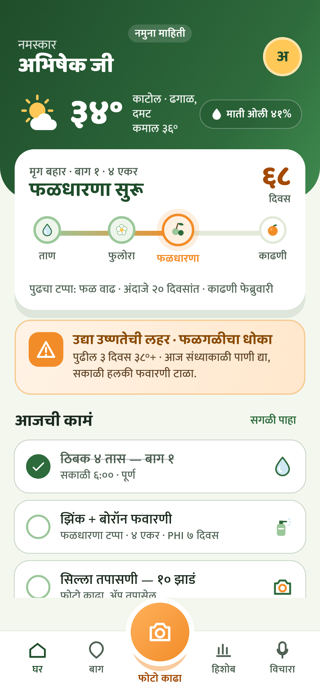
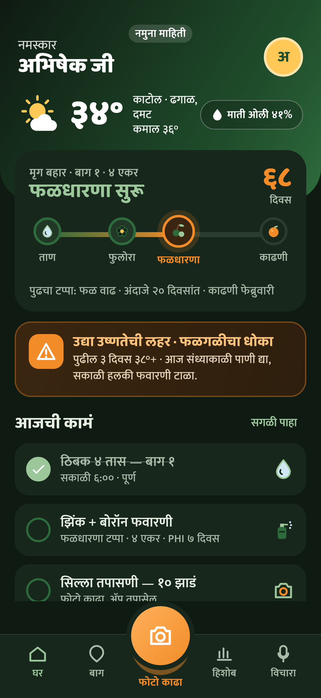
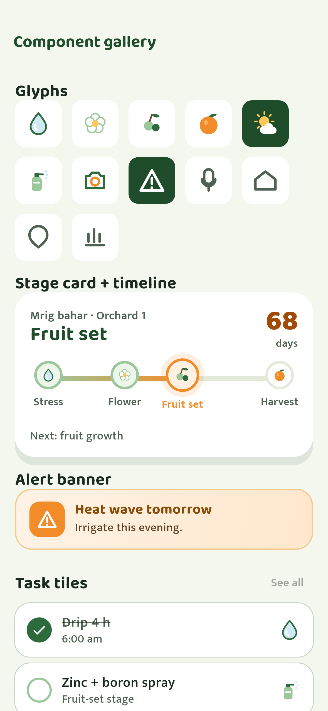

# BagMitra Design System (v0 — M0)

Direction: a warm orchard brand, not Material defaults — deep leaf green, santra orange accent,
soil browns, sky blue for weather, cream background. Reference: `reference/home_mockup.html`.
All tokens live in `app/lib/theme/tokens.dart`; raw colours anywhere else fail
`test/architecture/no_inline_colors_test.dart`. The full component inventory is rendered in the
in-app gallery (`--dart-define=DEV_GALLERY=true`, route `/dev/gallery`) and snapshotted by
`test/goldens/home_golden_test.dart`.

| Home (mr, light) | Home (mr, dark) | Component gallery |
|---|---|---|
|  |  |  |

## Tokens

**Colour (semantic, `BmColors` light / dark)**

| Token | Light | Dark | Use |
|---|---|---|---|
| background | cream `#F3F7EE` | `#0F1A12` | page |
| card | `#FFFFFF` | `#18271B` | cards, tiles |
| ink / inkMuted | `#1B2A1E` / `#4E6153` | `#E8F0E3` / `#A9BCA9` | text |
| brand / brandStrong / brandSoft | leaf `#1F4D2B` / `#2E6B3C` / `#9BC79A` | leaf-light inverted | headings, done states |
| accent / accentSoft | santra `#F28C28` / `#FFB15C` | same | fills: main buttons, camera, current stage |
| accentInk | santra-deep `#A34A06` | santra | accent used as **text** (dates, stale notes, stage days) — santra text is 2.4:1 on cream |
| onAccent | ink `#1B2A1E` | same | text/icons on a santra fill (white on santra fails in sunlight) |
| sun, soil, sky | `#FFC857`, `#6B4A2B`, `#CFE8F3` | same | weather, earth, water |
| warn* | warm orange gradient | deep amber | risk alerts |
| headerGradient | leaf → leaf2 → `#3F8A4F` | night → leaf → leaf2 | home header |

**Type:** Baloo 2 for display (hero 44, big number 34, money 30, title 26, card title 24,
section 20), Mukta for body (16 minimum; meta 14 and label 13 only for secondary metadata).

**Spacing:** 4 · 8 · 12 · 16 · 18 · 24 · 32. Tap target ≥ 48 dp.
**Radius:** chip 12 · tile 18 · card 22 · hero 24 · header 40 · pill.
**Elevation:** `card` (soft, leaf-tinted), `tile` (subtle), `fab` (santra glow).
**Motion:** quick 180 ms, gentle 320 ms, pulse 1.4 s; all disabled when the OS asks for reduced
motion (`MediaQuery.disableAnimations`).

## Components (`app/lib/design_system/`)

| Component | File | Notes |
|---|---|---|
| `BmCard`, `SectionHeader` | cards.dart | one hero element per card; header action is a 48 dp text button |
| `WeatherHeader` | weather_header.dart | curved gradient, greeting, avatar, temperature hero, soil pill |
| `StageCard`, `StageTimeline` | stage_timeline.dart | illustrated bahar timeline, animated progress, done/now/upcoming states |
| `AlertBanner` | alert_banner.dart | warm gradient, pulsing icon, live region for screen readers |
| `TaskTile` | task_tile.dart | animated tick, strike-through when done, pictogram |
| `PriceHeroCard` | price_card.dart | big rupee number with Indian grouping, weekly change chip |
| `BmBottomBar`, `CameraButton`, `VoiceButton` | navigation.dart | raised centre camera; mic affordance for voice entry |
| `SyncBanner` | sync_banner.dart | offline / pending / failed states |
| `GlyphIcon` | glyphs.dart | painted illustration set (ADR 0007) |
| `EmptyState`, `EmptyNote` | empty_state.dart | every empty list: glyph in soft circle, optional title, one line, optional action; `EmptyNote` for an empty line under filters/totals |
| `BottomActions` | bottom_actions.dart | pinned bottom strip for a screen's main action(s) (Save / Add); side-by-side buttons share the 56 dp height |

Themed in `theme/app_theme.dart`, so screens never style these by hand:
- **App bar**: page background, brand `section` title, brand icons, no scroll tint. Screens pass only title/actions.
- **Buttons**: filled = santra with dark ink text, 56 dp; outlined/text = brand, ≥ 48 dp, same 18 dp radius.
- **Chips**: picked = `nowTint` with santra border; unpicked = `line` border.
- **Inputs**: 18 dp radius; no `0/120` counters (the limit still applies); a mic (`VoiceMicButton`) on free-text name/note fields.
- **Form question labels** ("Which crop?") use `BmType.formLabel` (16 sp, w600, ink) — not the 13 sp `label`.
- **Placement**: data-entry forms and list screens put their main action in `BottomActions`; settings-style pages (profile, notification settings) keep Save at the end of the page.
- **Offline**: any "you are offline" notice is a `SyncBanner`, never a one-off box.

Checks: `test/architecture/ui_guidelines_test.dart` (48 dp tap targets + WCAG text contrast on key screens) and the
`*_x13` goldens (Marathi at 1.3× text size).

## Rules for every UI PR
Tokens only · Marathi strings fit without overflow · works offline · works in dark mode ·
golden added/updated · screenshots (light + dark, Marathi) in the PR · honest answer to
"would a grower show this to a neighbour?".

## Next (before M1 UI work)
Empty/success-state illustrations, chips, input components with voice, photo tiles, a 2 GB
device performance profile, and a golden that asserts Home fits a 5.5" screen (OPEN_QUESTIONS Q7).
